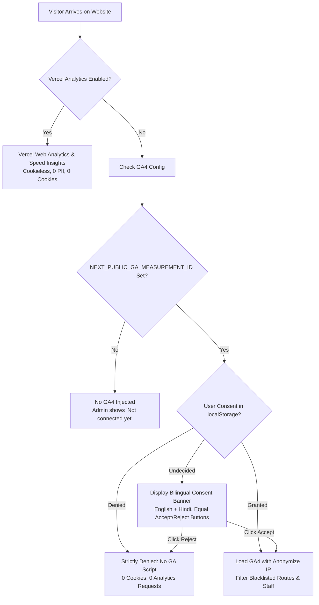

# 📊 Traffic Analytics & Privacy Documentation

> **Status:** Production-Ready & Compliant with Digital Personal Data Protection Act (DPDPA), 2023  
> **Telemetry Architecture:** Cookieless by Default + Optional Google Analytics 4 (Consent Mode v2)

---

## 1. Architectural Overview

Aapka Astro maintains a strict, privacy-first analytics stack designed so that the client/owner can clearly understand visitor volume, demographics, and popular content without compromising visitor confidentiality or violating data protection regulations.

---

## 2. Telemetry Engines & Providers

### A. Vercel Web Analytics & Speed Insights (Cookieless)
- **Activation Flag:** Controlled by environment variable `NEXT_PUBLIC_ENABLE_VERCEL_ANALYTICS=true` (or `NEXT_PUBLIC_VERCEL_ANALYTICS=true`).
- **Characteristics:**
  - **100% Cookieless:** Never drops cookies on the visitor's device.
  - **No PII:** IP addresses are anonymized and discarded at the edge.
  - **Safety Gate:** Excluded automatically from tracking on `/admin`, `/dashboard`, `/instructor`, and `/account`, as well as signed-in Owner and staff members.
  - **URL Sanitization:** Strips query parameters containing sensitive strings before dispatch.

### B. Google Analytics 4 (Consent Mode v2)
- **Activation Flag:** Only activated when `NEXT_PUBLIC_GA_MEASUREMENT_ID` is set (e.g., `G-XXXXXXXXXX`).
- **Default State:** Google Consent Mode v2 initializes with **everything denied by default**:
  - `analytics_storage: 'denied'`
  - `ad_storage: 'denied'`
  - `ad_user_data: 'denied'`
  - `ad_personalization: 'denied'`
- **Consent Banner:**
  - Short, non-intrusive banner rendered in **English and Hindi**.
  - Features **equally prominent** Accept (`स्वीकार करें`) and Reject (`अस्वीकार करें`) buttons.
  - Choice is remembered in browser `localStorage` under `aapka_cookie_consent`.
  - Links to `/privacy-policy` and `/cookie-policy`.
- **If Rejected:**
  - GA4 script is completely blocked from loading.
  - Zero analytics cookies (`_ga`, `_ga_*`) are set.
  - Zero network requests are sent to Google servers.

---

## 3. Strict Privacy & PII Safety Rules

1. **Zero PII in Events or URLs:**
   - **Never** put an email address, phone number, 12-digit UTR, personal seeker name, or booking reference (`ASTRO-...`, `VAASTU-...`) into an event parameter, page title, or URL query.
   - All event payloads pass through `src/lib/analytics/piiSanitizer.ts`, which automatically redacts matching regex patterns:
     - Emails: `[REDACTED_EMAIL]`
     - Phones: `[REDACTED_PHONE]`
     - UTRs: `[REDACTED_UTR]`
     - Booking IDs: `[REDACTED_REF]`
   - Sensitive payload keys (`email`, `phone`, `name`, `utr`, `dob`, etc.) are permanently stripped.

2. **Exclusion Blacklist:**
   - **Routes Never Tracked:**
     - `/admin` and all sub-routes (`/admin/*`)
     - `/dashboard` and all sub-routes (`/dashboard/*`)
     - `/instructor` and all sub-routes (`/instructor/*`)
     - `/account` and all sub-routes (`/account/*`)
   - **Users Never Tracked:**
     - Signed-in Owner (`aapkaastro1606@gmail.com`)
     - Staff members (`role: "OWNER" | "STAFF" | "ADMIN" | "ASTROLOGER" | "INSTRUCTOR"`)

---

## 4. Master Events Catalog

All events are defined and dispatched through `@/lib/analytics/trackEvent`:

| Event Name | Trigger / Context | Sanitized Parameters | Notes |
| :--- | :--- | :--- | :--- |
| `click_whatsapp` | Click on WhatsApp link or button anywhere on site | `{ placement: "header" \| "footer" \| "body", channel: "whatsapp" }` | Automatically captured by `GlobalClickTracker` |
| `click_call` | Click on `tel:` phone link | `{ placement: "header" \| "footer" \| "body", channel: "phone" }` | Automatically captured by `GlobalClickTracker` |
| `chatbot_opened` | Visitor clicks floating assistant trigger | `{ interface: "floating_assistant" }` | Fired when AI assistant expands |
| `language_switched` | Visitor changes site language | `{ target_lang: "en" \| "hi" }` | Fired on language context update |
| `contact_form_sent` | Callback / Contact form submitted | `{ topic: "kundli" \| "vastu" \| "general" }` | Strictly **NO** name, email, or phone |
| `course_page_viewed` | Educational article or course page viewed | `{ course_title: string }` | Measures interest in Vedic courses & guides |
| `free_kundli_generated` | Visitor calculates free Janam Kundli | `{ calculation_engine: "vedic_ephemeris", has_dasha: true }` | **Aapka Astro**: Lead generation milestone |
| `booking_started` | Consultation booking modal opened or format picked | `{ product_type: "astro" \| "vaastu", format: "AUDIO" \| "VIDEO" \| "CHAT" }` | **Aapka Astro**: Checkout funnel step 1 |
| `payment_claimed` | Seeker submits UPI payment claim | `{ product_type: "astro" \| "vaastu" \| "kundli_pdf", amount: number, currency: "INR" }` | **Aapka Astro**: Checkout funnel step 2. Strictly **NO UTR** |
| `enrolment_started` | Student initiates course enrolment | `{ course_id: string }` | **Viar compatibility** |
| `enquiry_whatsapp` | Seeker initiates WhatsApp enquiry | `{ channel: "whatsapp" }` | **DOW compatibility** |
| `enquiry_call` | Seeker initiates telephone enquiry | `{ channel: "call" }` | **DOW compatibility** |

---

## 5. Retention Periods & Third-Party Processors

| Processor | Purpose | Data Retained | Retention Duration |
| :--- | :--- | :--- | :--- |
| **Vercel Inc.** | Cookieless Web Vitals & Loading Speed | Aggregated page load times & anonymous daily checksum | 24 Hours |
| **Google LLC** | Traffic Acquisition & Page Views (Consent Required) | Anonymized events, device category, country/city | **2 Months** (User default) up to **14 Months** (Maximum GA4 window) |
| **Clerk Inc.** | Authentication Sessions (Essential) | Encrypted session cookies (`__session`) | Session to 7 Days |

---

## 6. Admin Home "Traffic" Tile & Client Guidance

Located at [`/admin/analytics`](https://www.aapkaastro.com/admin/analytics) and the **"Visitor Traffic & Search Analytics"** tile on the Admin Hub:

### What the Client Sees:
1. **Connection Status:**
   - If `NEXT_PUBLIC_GA_MEASUREMENT_ID` is set: **"Connected (GA4: G-XXXXXXXXXX)"**.
   - If not set: **"Not connected yet"** with step-by-step setup guidance.
2. **Zero Invented Numbers:**
   - No mock charts, fake visitor graphs, or simulated metrics.
   - Real database KPIs (actual verified Kundlis and consultation bookings) are loaded from PostgreSQL.
3. **Answers to the 3 Essential Operator Questions:**
   - **Question 1: How many people visited this week?**  
     *Direct deep-link to Google Analytics 4 Traffic Acquisition Report with "Last 7 Days" filter.*
   - **Question 2: From which countries and cities?**  
     *Direct deep-link to Demographic Details with Country & City breakdown.*
   - **Question 3: Which pages did they read?**  
     *Direct deep-link to Pages and Screens Report ranking most viewed articles, calculators, and consultation types.*
   - **Search Console:**  
     *Direct deep-link to Google Search Console to inspect top Google organic search queries.*
